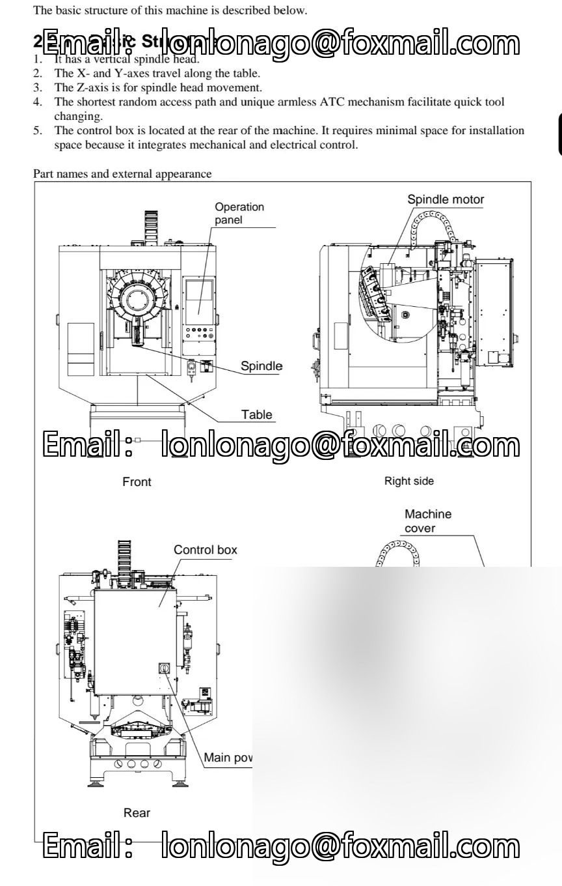
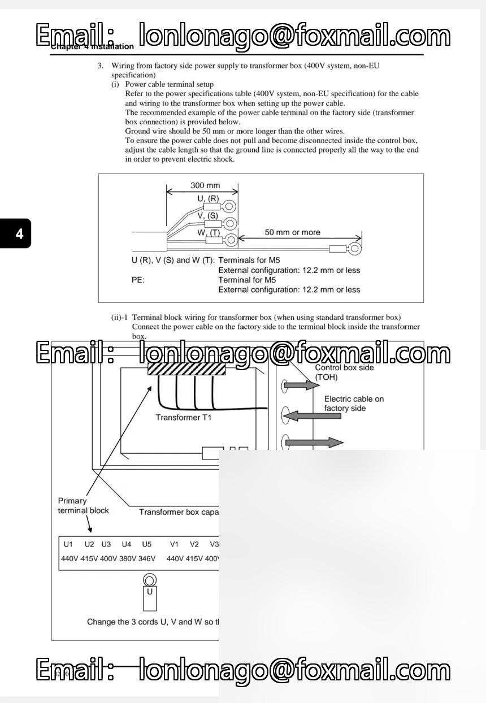
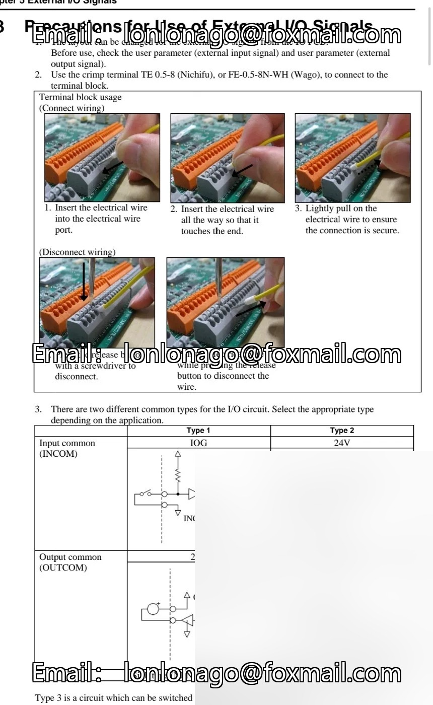
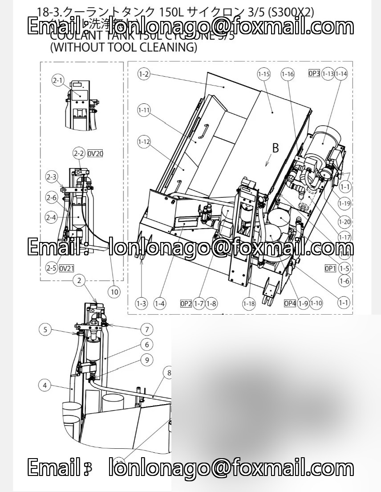
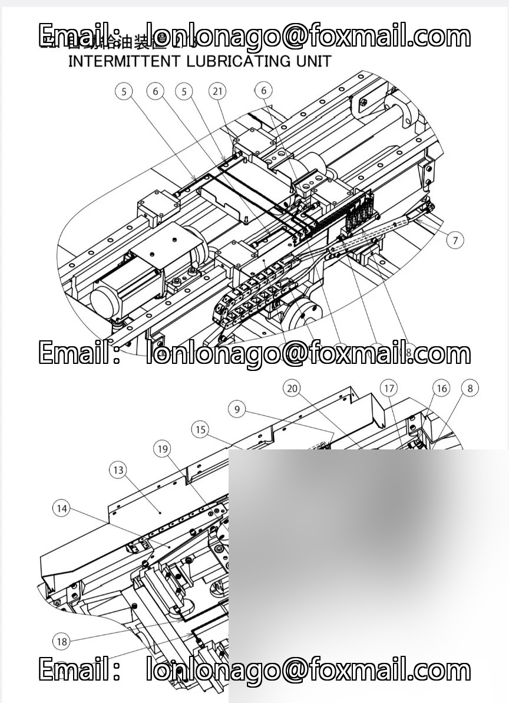

# Brother SPEEDIO S300X2 / S500X

## Body

Brother SPEEDIO S300X2 / S500X2 / S700X2 Compact BT30 Machining Center Data
PDF , 800 pages, content covers structure, installation, external I/O signals, cooling system, lubrication system, etc., suitable for device operation, maintenance, and learning reference.

Brother SPEEDIO S300X2 / S500X2 / S700X2 are Brother Industrial (Nagoya) products of the same platform—a BT30 vertical compact machining center (high-speed drilling and milling / drilling and tapping center). The differences between the three lie solely in the X-axis travel: 300 / 500 / 700 mm, while Y=400 mm, Z=300 mm, overall structure, control architecture, shift performance (X/Y at 50 m/min, Z at 56 m/min), and a drum ATC (bit-to-bit ~0.7 s, chip-to-chip ~1.3 s; 14/21 heads, MAS‑BT30, randomly selecting the nearest tool) remain unchanged.

Spindle standard speed is 10,000 min⁻¹, selectable at 10,000 / 16,000 / 27,000 min⁻¹ (27k cannot be matched with CTS), taper hole is 7:24 No.30 BT, selectable BIG‑PLUS bilateral constraint and CTS, factory marking bidirectional positioning accuracy is approximately 0.006–0.020 mm, repeatability <0.004 mm, entire machine footprint is approximately 1,080×2,463 / 1,560×2,223 / 2,050×2,223 mm, positioning does not use BT40 level heavy cutting but makes drilling, threading, light milling for small to medium-sized parts—especially aluminum/copper/non-ferrous and some steel—under very small

Floor space achieves high cycle time, high loading density, suitable for multi-machine connection or unitized mass production (for automobiles, 3C/electronic shells, precision hardware, etc.).

The X2 generation (CNC‑C00) in the product series has been replaced by the subsequent Xd2 generation (CNC‑D00, Y extended to 450, with optional 28 toolchains, etc.), and the selection essentially involves making a trade-off among the path/fixture space/automation layout and spindle specifications.

The material covers the machine's basic structure, axis movements, control architecture, installation wiring, external appearance and operation.

<!-- AI_ENRICHED -->

## Images

## Payment

Here is a pay link on Stripe ( https://buy.stripe.com/3cs8yP7sY87d0vu9AB ). Please contact me lonlonago@foxmail.com after funding $89, and I will send you a complete data files , thank you!

